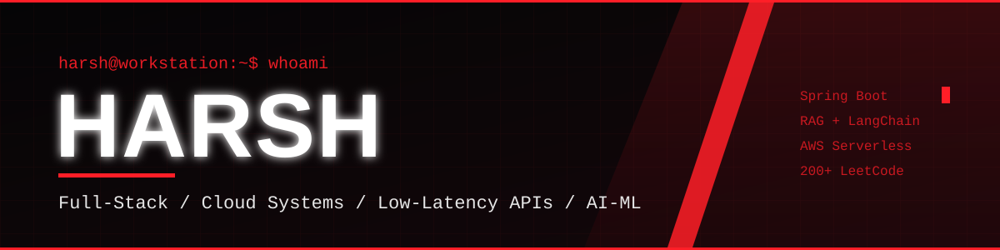

<div align="center">

  <!-- Local Custom Obsidian & Crimson Vector Banner -->
  

  <br/>

  <!-- Animated Glowing Red Typing Subtitle -->
  <a href="https://github.com/harsh07-builds">
    
  </a>

  <br/>

  <!-- Status & Highlight Badges -->
  <p align="center">
    
    
    
    
  </p>

  <!-- Connect Links in Red & Black -->
  <p align="center">
    <a href="https://www.linkedin.com/in/harsh-19b565383" target="_blank">
      
    </a>
    <a href="mailto:harsh.connect.in@gmail.com">
      
    </a>
    <a href="https://github.com/harsh07-builds">
      
    </a>
  </p>

</div>

---

### ⚔️ Terminal Profile

```zsh
harsh@workstation:~$ neofetch --profile
-------------------------------------------------------------------------
> Name          : Harsh
> Focus         : Full-Stack Engineering, Cloud Systems, Low-Latency APIs & AI/ML
> Education     : B.Tech in CSE (AI & ML) @ VIT Bhopal University (SGPA: 8.65)
> Core Stack    : Spring Boot • React • RAG • LangChain • PostgreSQL • Redis
> Cloud & Ops   : AWS (Lambda, EventBridge, SQS, API GW, Step Functions, CloudWatch) • Docker
> Problem Solver: 200+ LeetCode DSA Solutions in Java
> Achievements  : Finalist @ JHU × VITB Health Hackathon 2026
-------------------------------------------------------------------------
```

---

### 🏆 Honors & Key Engineering Highlights

<table width="100%">
  <tr>
    <td width="50%" valign="top">
      <h4>⚡ Core Engineering Highlights</h4>
      <ul>
        <li>📡 <b>Offline-First Systems:</b> Built <b>SetuSync</b>, a knowledge-sharing platform using digitally signed capsules, QR, Bluetooth and peer-to-peer sync.</li>
        <li>🤖 <b>RAG Pipelines:</b> Shipped retrieval-augmented chatbots with <b>LangChain, FAISS</b> and <b>HuggingFace</b> embeddings behind <b>FastAPI</b>.</li>
        <li>👁️ <b>Assistive AI:</b> Designed a CPU-only, no-cloud <b>YOLOv8</b> pipeline that speaks spatial scene descriptions, with fuzz-tested guardrails.</li>
        <li>☁️ <b>Cloud Architecture:</b> Working with AWS serverless stacks (Lambda, EventBridge, SQS, Step Functions, CloudWatch).</li>
      </ul>
    </td>
    <td width="50%" valign="top">
      <h4>🎖️ Honors &amp; Milestones</h4>
      <ul>
        <li>🏆 <b>Finalist</b> — <i>JHU × VITB Health Hackathon 2026</i></li>
        <li>🧠 <b>200+ DSA Problems Solved</b> on <i>LeetCode</i> in <i>Java</i>.</li>
        <li>🎓 <b>8.65 SGPA</b> — <i>B.Tech CSE (AI &amp; ML), VIT Bhopal University</i></li>
      </ul>
    </td>
  </tr>
</table>

---

  <!-- Crimson Contribution Snake Animation -->
  <picture>
    <source media="(prefers-color-scheme: dark)" srcset="https://raw.githubusercontent.com/harsh07-builds/harsh07-builds/output/github-contribution-grid-snake-dark.svg">
    <source media="(prefers-color-scheme: light)" srcset="https://raw.githubusercontent.com/harsh07-builds/harsh07-builds/output/github-contribution-grid-snake.svg">
    
  </picture>

---

### 🛠️ Weapons of Choice (Tech Stack)

<div align="center">
  <p>
    <a href="https://skillicons.dev">
      
    </a>
  </p>
</div>

<table width="100%">
  <tr>
    <td width="33%" valign="top">
      <b>💻 Languages &amp; Frontend</b><br/>
      <code>Java</code> <code>Python</code> <code>HTML5</code> <code>React</code> <code>Tailwind CSS</code>
    </td>
    <td width="33%" valign="top">
      <b>⚙️ Backend, Data &amp; AI</b><br/>
      <code>Spring Boot</code> <code>FastAPI</code> <code>REST APIs</code> <code>PostgreSQL</code> <code>MySQL</code> <code>Redis</code> <code>RAG</code> <code>LangChain</code> <code>FAISS</code> <code>YOLOv8</code>
    </td>
    <td width="33%" valign="top">
      <b>☁️ Cloud &amp; DevOps</b><br/>
      <code>AWS Lambda</code> <code>API Gateway</code> <code>EventBridge</code> <code>SQS</code> <code>Step Functions</code> <code>CloudWatch</code> <code>Docker</code> <code>Git</code> <code>VS Code</code>
    </td>
  </tr>
</table>

---

### 🚀 Featured Repositories & Engineering Builds

| Project | Highlights & Architecture | Tech Stack | Link |
| :--- | :--- | :--- | :---: |
| 📡 **SetuSync** | Offline-first knowledge-sharing platform for secure information exchange. Digitally signed knowledge capsules shared over QR, Bluetooth, peer-to-peer and network sync, with local and semantic search, integrity verification, delta sync, freshness policies and background sync for low-connectivity environments. | `Spring Boot` `PostgreSQL` `TypeScript` `PWA` `AWS` | [Repo](https://github.com/harsh07-builds/SetuSync) |
| 🌊 **ARGO RAG Chatbot** | Retrieval-Augmented Generation chatbot that answers questions from custom ARGO oceanographic data using vector search over HuggingFace embeddings. | `LangChain` `FAISS` `HuggingFace` `FastAPI` | [Repo](https://github.com/harsh07-builds/ARGO-rag-chatbot) |
| 🦯 **Scene Narrator** | Offline assistive pipeline that turns camera images into spoken spatial descriptions ("A laptop is resting on the desk"). YOLOv8 detection → geometric spatial reasoning → deterministic NLG → TTS. CPU-only, no cloud, fuzz-tested plausibility guardrails and CI. | `YOLOv8` `FastAPI` `Streamlit` `Python` `TTS` | [Repo](https://github.com/harsh07-builds/scene-narrator-for-accessibility) |

### ⚡ Philosophy

<div align="center">
  <blockquote>
    “Code is like humor. When you have to explain it, it’s bad.” – Cory House 😄
  </blockquote>
  <p>🔥 Passionate about building robust distributed systems, low-latency APIs, and intelligent AI-powered applications.</p>
</div>

<div align="center">
  
</div>
